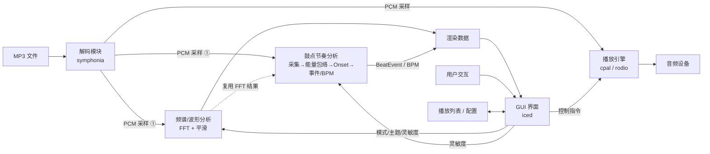

# MP3 图形化播放器 — 软件需求规格说明书（SRS）

| 项目 | 内容 |
| --- | --- |
| 文档名称 | MP3 图形化播放器 软件需求规格说明书 |
| 版本 | v1.11（草稿） |
| 状态 | 待评审 |
| 创建日期 | 2026-11-18 |
| 适用语言 | Rust |
| 目标平台 | Windows / macOS / Linux（桌面端） |

> 修订历史

| 版本 | 日期 | 修订人 | 说明 |
| --- | --- | --- | --- |
| v1.0 | 2026-11-18 | — | 初稿，确立范围与功能清单 |
| v1.1 | 2026-11-18 | — | 新增「鼓点节奏专项」：采集、计算、图形化侧重点，并同步更新架构/数据模型/验收/里程碑 |
| v1.2 | 2026-11-19 | — | 新增「歌词展示与自动对齐」：LRC 解析、纯文本歌词基于能量包络的启发式强制对齐、歌词叠加展示 |
| v1.3 | 2026-11-20 | — | 新增「区域录屏导出」：只录中央动效+歌词区、内嵌当前曲目音轨、异步编码与合并 |
| v1.4 | 2026-11-20 | — | 新增「粒子流」可视化模式（FR-3.13）：节奏驱动的炫彩粒子拖尾 + 随机几何锚定物 + 向右前行感 |
| v1.5 | 2026-11-20 | — | 粒子流锚定物增强（FR-3.13）：几何绑定低/中/高频段按能量出现、生命周期渐隐、拖尾随对应频率波动 |
| v1.6 | 2026-11-20 | — | 新增「歌词模式」（FR-3.14）：动效区仅显示逐字炫彩歌词，字号随律动/节奏弹跳；无歌词时几何图形占位 |
| v1.7 | 2026-11-20 | — | 新增「炫彩光带」模式（FR-3.15）：白色网格背景 + 随音波/鼓点跳动的炫彩曲线 + 震动甩出的渐隐粒子 |
| v1.8 | 2026-11-20 | — | 炫彩光带背景升级为白色透视空间网格（FR-3.15）：消失点放射纵线 + pow 加密横线 + 深度分段着色 + 渐变底，形成隧道式立体纵深感 |
| v1.9 | 2026-11-20 | — | 修复录屏音轨沙沙声（FR-8.2）：音轨改为连续游标推进，消除 position 与 wall-clock 漂移导致的帧边界波形重叠/跳跃 |
| v1.10 | 2026-11-20 | — | 各模式锚点/占位几何加入圆形（FR-3.13 / FR-3.14）：粒子流三频段形状池均增加圆形锚定物（24 段近似），歌词模式无歌词占位从 5 种扩展为 6 种（新增圆形） |
| v1.11 | 2026-11-20 | — | 炫彩光带改为三条分频段曲线（FR-3.15）：高/中/低频各取 spectrum 对应区间并叠加共享波形起伏，独立能量调制振幅/跳动，分色段取色（暖/中/冷），粒子按频段加权从对应线发射 |

---

## 1. 引言

### 1.1 编写目的

本文档定义一款以 Rust 开发的**桌面 MP3 播放器**的完整需求，重点在于**播放过程中的实时音频可视化**（频谱、波形，以及对鼓点节奏的专项采集、计算与图形化呈现）。文档作为后续架构设计、编码实现与验收测试的共同依据，明确"做什么"与"做到什么程度"，暂不规定具体实现细节。

### 1.2 项目背景

Rust 兼具内存安全与高性能，适合编写对实时性有要求的音频应用；同时其现代 GUI 生态（iced / egui / Slint 等）已能满足桌面应用需求。本项目旨在打造一个轻量、流畅、可视效果出色的本地音乐播放器，既可作为实用工具，也可作为 Rust 音频 + GUI 技术栈的示例工程。

### 1.3 范围

- **在产品范围内**：本地 MP3 文件读取、解码、播放控制、播放列表、实时频谱/波形可视化、**鼓点/节奏的专项采集与计算及图形化呈现**、元数据展示、基础设置。
- **不在范围内**：在线音乐/流媒体、账号体系、音乐推荐、云端同步、音频编辑、非 MP3 格式的深度支持（仅预留扩展）。

### 1.4 定义与缩略语

| 术语 | 含义 |
| --- | --- |
| FFT | 快速傅里叶变换，用于把音频时域信号转换为频域，驱动频谱显示 |
| 频谱 | 音频各频率分量的能量分布，常以柱状图呈现 |
| 波形 | 音频信号振幅随时间变化的曲线 |
| PCM | 脉冲编码调制，解码后的原始音频采样数据 |
| 鼓点 / 节拍 Beat | 音乐中的瞬时打击事件（如底鼓 Kick、军鼓 Snare、踩镲 Hi-hat），是节奏可视化的触发源 |
| Onset | 音频能量的突变起点，常用于检测鼓点发生时刻 |
| 能量包络 | 音频信号能量随时间变化的曲线，是鼓点检测的基础特征 |
| BPM | 每分钟节拍数（Beats Per Minute），用于衡量节奏快慢 |
| MoSCoW | 需求优先级方法：Must / Should / Could / Won't |

---

## 2. 总体描述

### 2.1 产品定位

一个**轻量、美观、以节奏为核心的本地 MP3 播放器**。核心体验是"边听边看"——播放音乐的同时，频谱与波形随声音动态变化，并通过**对鼓点的专项采集与计算**驱动脉冲、光晕、放射等图形效果，让画面随节拍"踩点"，同时提供多种视觉风格切换。

### 2.2 目标用户

- 希望在本地安静听歌、同时喜欢视觉效果的音乐爱好者。
- 想学习/验证 Rust 音频处理与 GUI 开发的开发者。
- 对资源占用敏感、偏好轻量原生应用的用户。

### 2.3 运行环境

| 项 | 要求 |
| --- | --- |
| 操作系统 | Windows 10+、macOS 11+、主流 Linux 发行版 |
| 架构 | x86_64、ARM64（Apple Silicon） |
| 运行时 | 无需额外运行时；音频后端依赖系统音频设备（WASAPI / CoreAudio / ALSA / PulseAudio） |
| 最低内存 | 建议 ≥ 256 MB 可用内存 |

### 2.4 典型使用场景

1. **导入并播放**：启动程序 → 添加本地 MP3 文件或文件夹 → 双击曲目播放 → 观察频谱、波形与鼓点视觉特效跳动。
2. **感受节奏**：播放节奏感强的曲目（电子、摇滚、嘻哈）→ 画面随底鼓/军鼓脉冲与闪光，观察 BPM 与节拍指示。
3. **后台听歌**：最小化到托盘（可选）继续播放，通过快捷键控制。
4. **切换视觉风格**：在播放中切换频谱/波形/混合/节奏模式，更换配色主题与鼓点灵敏度。
5. **管理歌单**：拖拽排序、移除曲目，程序记住上次播放列表。

### 2.5 设计原则

- **响应流畅**：音频回调与 UI 渲染解耦，可视化不卡顿、不阻塞播放；鼓点检测与频谱分析共用同一份采样、并行计算。
- **节奏优先**：鼓点作为视觉表现的"主时钟"，检测结果与画面反馈保持低延迟、强同步。
- **轻量聚焦**：默认界面简洁，高级功能按需展开。
- **可扩展**：解码与可视化模块解耦，便于日后支持更多格式与效果。
- **安全可靠**：不修改用户原始音频文件；崩溃不损坏播放列表数据。

---

## 3. 功能需求

优先级采用 MoSCoW：**M**（Must，MVP 必备）/ **S**（Should，重要）/ **C**（Could，锦上添花）。

### 3.1 音频播放

| 编号 | 功能 | 描述 | 优先级 |
| --- | --- | --- | --- |
| FR-1.1 | 播放/暂停 | 开始或暂停当前曲目，状态在 UI 明确显示 | M |
| FR-1.2 | 停止 | 停止播放并回到起始位置 | M |
| FR-1.3 | 上一曲/下一曲 | 按播放列表顺序切换曲目 | M |
| FR-1.4 | 进度跳转（Seek） | 拖动进度条跳转到指定时间点 | M |
| FR-1.5 | 音量控制 | 0–100% 音量调节，带静音切换 | M |
| FR-1.6 | 播放模式 | 顺序播放、单曲循环、列表循环、随机播放 | S |
| FR-1.7 | 播放速度 | 0.5×–2.0× 变速播放 | C |
| FR-1.8 | 淡入淡出 | 切歌时短促淡入淡出，避免爆音 | C |

**验收要点**：点击播放后 1 秒内出声；Seek 后从新位置继续；音量 0 时静音且可恢复；切歌无爆音（FR-1.8 启用时）。

### 3.2 播放列表与文件管理

| 编号 | 功能 | 描述 | 优先级 |
| --- | --- | --- | --- |
| FR-2.1 | 添加文件 | 通过文件选择器添加单个/多个 MP3 文件 | M |
| FR-2.2 | 添加文件夹 | 递归添加文件夹内的 MP3 文件 | S |
| FR-2.3 | 拖拽导入 | 从系统文件管理器拖拽 MP3 到窗口添加 | S |
| FR-2.4 | 列表展示 | 显示曲目名、艺术家、时长等信息 | M |
| FR-2.5 | 排序与移除 | 支持拖拽调整顺序、单曲/批量移除 | S |
| FR-2.6 | 列表持久化 | 程序退出时保存播放列表，下次启动恢复 | S |
| FR-2.7 | 搜索过滤 | 按标题/艺术家关键字过滤列表 | C |

**验收要点**：添加重复文件时按策略去重或提示；移除正在播放的曲目能正确切换到下一曲；重启后列表与顺序保持一致。

### 3.3 音频可视化（核心）

| 编号 | 功能 | 描述 | 优先级 |
| --- | --- | --- | --- |
| FR-3.1 | 实时频谱 | 基于 FFT 的柱状频谱，随音乐实时跳动 | M |
| FR-3.2 | 实时波形 | 显示时域波形曲线 | M |
| FR-3.3 | 可视化模式切换 | 频谱 / 波形 / 混合 / **节奏** 四种模式可切换 | S |
| FR-3.4 | 频段与灵敏度 | 可调频段数量、频谱平滑度与增益 | S |
| FR-3.5 | 配色主题 | 内置多套配色（如霓虹、渐变、单色），可切换 | S |
| FR-3.6 | **鼓点专项采集** | 从 PCM 中分流并预处理，为节奏分析提供专用数据流（见 3.3.1） | M |
| FR-3.7 | **鼓点计算与检测** | 计算能量包络、检测 Onset、识别鼓点事件与强度（见 3.3.1） | M |
| FR-3.8 | **鼓点图形化呈现** | 以脉冲/光晕/放射等效果响应鼓点，作为视觉侧重点（见 3.3.1） | M |
| FR-3.9 | BPM 与节拍指示 | 估计并显示 BPM，提供节拍指示/律动条 | S |
| FR-3.10 | 圆形/放射频谱 | 提供圆形放射状频谱作为高级视觉模式 | C |
| FR-3.11 | 暂停冻结 | 暂停时可视化画面定格，恢复后继续 | M |
| FR-3.12 | 无音频待机 | 无播放时显示待机动画或静态占位画面 | C |
| FR-3.13 | 粒子流模式 | 独立的「粒子流」可视化模式：炫彩粒子随鼓点爆发/跳动并向右漂移，带渐隐拖尾；几何锚定物按频段绑定（低频厚重：方/六边形/菱形/圆形，中频均衡：五边形/菱形/三角/圆形，高频尖锐：三角/星形/六边形/圆形；圆形以 24 段正多边形近似，旋转对称故不显自转但仍随鼓点跳动缩放），出现概率由对应频段能量加权，色段与主题色带对应；每个锚定物有生命周期（淡入→维持→渐隐），结束时按当前频谱重新选频段；锚定物拖尾按所属频率做正弦波动（低频慢而摆幅大、高频快而摆幅小）；鼓点触发同频段几何体「原地变形」（保留位置与拖尾，避免频繁鼓点导致几何体堆积在左侧）；回收重生时横向位置分散选取；背景速度线营造向右前行感 | S |
| FR-3.14 | 歌词模式 | 独立的「歌词模式」：动效区独占整块内容区，仅显示歌词文字（不叠加频谱/圆盘/网格/粒子等图形）；当前行逐字取主题色带来生成炫彩配色，字与字色相错开并随时间流动；按行内进度定位当前唱到的字（空格不计入），仅该字显著放大（鼓点额外弹跳）并带三层柔光辉光，其余字保持固定字号与槽位；上下文行弱化且不跳动；焦点字切换按行内人声能量谷（发音间隙）划分边界，贴合实际发音而非均匀时间；未加载歌词或歌词为空时，以 6 个主题色几何图形（三角/方/五边形/六边形/菱形/圆，圆形以 24 段近似）随节奏跳动占位，不显示文字提示 | S |
| FR-3.15 | 炫彩光带模式 | 独立的「炫彩光带」可视化模式：**白色透视空间网格背景**（区别于其他深色模式）——消失点位于画面正中，纵线自消失点向上下边缘放射收敛，横线按 pow 规律向消失点加密（近疏远密），线段按深度分段着色（远处淡而细、近处浓而粗），背景为中部最白、上下略灰的渐变，形成隧道式立体纵深感；**三条分频段炫彩曲线**，自上而下按 高频/中频/低频 分层排列（低频厚重在下、高频轻盈在上）：各线分别取混合频谱 spectrum 的对应 bin 区间（低 0~44 / 中 44~148 / 高 148~256）驱动形状，并叠加共享波形起伏（非线性放大，各线系数有正有负 → 错落而非平行，避免纯频谱驱动过于平直）；每条线独立按所属频段能量+鼓点脉冲+节拍相位调制振幅与跳动（低频跳幅大、高频小），颜色取主题色带的不同色段（低=暖 0~0.30 / 中=0.32~0.66 / 高=冷 0.68~1.0）并随时间流动，线宽低频最粗高频最细，切换色系整屏换色；曲线震动时持续甩出**粒子**，按频段能量加权从对应曲线发射、继承该线颜色与局部斜率/跳动方向四散飞行（带轻微重力/阻尼），生命周期内透明度渐隐，浅色粒子加浅灰描边保证白底可见；粒子数设上限防止无限增长；模式自带白底，跳过通用网格与鼓点叠加，暂停提示用深色 | S |

**验收要点**：可视化与声音**同步**（延迟感知 < 100 ms）；帧率目标 ≥ 30 FPS（建议 60 FPS）；切换模式/主题即时生效；暂停时画面冻结不漂移；高音量下频谱不溢出画面；鼓点视觉反馈与实际鼓点对齐（详见 3.3.1 验收项）。

#### 3.3.1 鼓点节奏专项设计（采集 · 计算 · 图形化）

鼓点节奏是本产品可视化的**侧重点与差异化能力**：不是简单地让频谱跟随音量跳动，而是把"鼓点"作为独立的信号对象，走完**专项采集 → 专项计算 → 专项图形化**的完整链路。三者的分工与边界如下。

##### (1) 专项采集（Acquisition）

| 编号 | 需求 | 说明 | 优先级 |
| --- | --- | --- | --- |
| FR-3.6.1 | PCM 采样分流 | 解码后的 PCM 在送入播放引擎的同时，复制一份送入节奏分析通道，与频谱分析共用采样源，避免重复解码 | M |
| FR-3.6.2 | 分帧与缓冲 | 以固定帧长（如 1024/2048 samples）与 hop size（如 512）滑窗，写入环形缓冲区；采样率统一（如 44.1 kHz） | M |
| FR-3.6.3 | 频段拆分 | 通过滤波器组或 FFT 分频段提取：低频（底鼓 Kick，约 20–150 Hz）、中频（军鼓 Snare，约 150–2000 Hz）、高频（踩镲 Hi-hat，约 2 kHz 以上） | S |
| FR-3.6.4 | 预加重与归一 | 对采样做预加重、加窗（Hann）与幅度归一化，抑制噪声与帧边界泄漏 | S |

> 采集层输出：分帧后的 PCM 数据 + 分频段能量序列，作为计算层的输入。该层只做"取数与预处理"，不做节拍判定。

##### (2) 专项计算（Analysis & Detection）

| 编号 | 需求 | 说明 | 优先级 |
| --- | --- | --- | --- |
| FR-3.7.1 | 能量包络 | 逐帧计算各频段（尤其低频）的短时能量，形成能量包络曲线 | M |
| FR-3.7.2 | Onset 检测 | 对能量包络做差分/谱通量，检测能量突变起始点，定位鼓点候选时刻 | M |
| FR-3.7.3 | 自适应阈值 | 基于局部均值/方差动态设定阈值，区分真鼓点与背景波动，减少误检/漏检 | M |
| FR-3.7.4 | 鼓点事件与强度 | 输出统一事件 `BeatEvent{ time, kind(Kick/Snare/Hihat), strength(0..1) }`，强度供图形层映射 | M |
| FR-3.7.5 | 节拍去抖 | 设置最小触发间隔（如 ≥ 200 ms）与峰值极大值筛选，避免同一鼓点重复触发 | S |
| FR-3.7.6 | BPM 估计 | 基于相邻鼓点间隔的直方图/自相关估计 BPM，并做时间平滑，稳定显示 | S |
| FR-3.7.7 | 节拍相位/律动 | 推算节拍网格（beat phase），供律动条与呼吸光效使用 | C |
| FR-3.7.8 | 参数可调 | 灵敏度、阈值系数、最小间隔等暴露为设置项，适配不同曲风 | S |

> 计算层输出：`BeatEvent` 事件流 + BPM + 节拍相位。检测延迟目标 ≤ 80 ms，保证图形反馈跟得上耳朵。

##### (3) 图形化呈现（Visualization）—— 侧重点

| 编号 | 需求 | 说明 | 优先级 |
| --- | --- | --- | --- |
| FR-3.8.1 | 鼓点脉冲 | 每个 Kick 触发一次全屏或中心区域的亮度/缩放脉冲，强度由 `strength` 映射 | M |
| FR-3.8.2 | 频谱冲击联动 | 鼓点命中时对应频段柱体高亮/放大并缓慢回落（peak-hold + 衰减），强化"踩点"感 | M |
| FR-3.8.3 | 放射/光晕 | 从画面中心向外扩散的光环或粒子冲击波，随鼓点类型（Kick/Snare/Hihat）呈现不同半径/颜色 | S |
| FR-3.8.4 | 节奏模式 | 提供专门的"节奏"可视化模式：以鼓点与 BPM 为主角，弱化普通波形 | S |
| FR-3.8.5 | BPM/节拍指示 | 屏幕内显示 BPM 数值与随拍跳动的指示灯/律动环 | S |
| FR-3.8.6 | 强度分级映射 | 强弱鼓点用不同幅度/饱和度表达，弱拍不喧宾夺主 | S |
| FR-3.8.7 | 平滑衰减曲线 | 视觉反馈使用可配置的衰减（如指数衰减），避免闪烁突兀、保持观感连贯 | S |

> 图形化原则：鼓点是"主角"，频谱/波形是"背景"。视觉重心随鼓点走，普通频谱提供连续性，两者叠加形成有节奏韵律的画面。

**鼓点专项验收项**：

1. 对节奏清晰的曲目（电子/流行/摇滚），在默认参数下鼓点检测召回率主观评估 > 80%，明显误检 < 每 10 秒 1 次。
2. 鼓点视觉反馈与可听鼓点的时间对齐，感知延迟 ≤ 100 ms。
3. 连续播放中 BPM 估计在曲风稳定时收敛到合理值（误差在 ±5 BPM 内），切换曲目后能重新收敛。
4. 调节灵敏度后，检测灵敏度随之明显变化；极端灵敏/迟钝设置下不崩溃。
5. 暂停时鼓点事件流停止，画面冻结；恢复后从当前位置继续，不产生堆积事件。

### 3.4 交互与控制

| 编号 | 功能 | 描述 | 优先级 |
| --- | --- | --- | --- |
| FR-4.1 | 窗口基础操作 | 最小化、最大化、关闭，窗口可缩放 | M |
| FR-4.2 | 键盘快捷键 | 空格播放/暂停、方向键 Seek/音量、上下曲等 | S |
| FR-4.3 | 托盘控制 | 最小化到系统托盘，托盘菜单控制播放与退出 | C |
| FR-4.4 | 全屏可视化 | 隐藏控件进入纯可视化全屏模式 | C |
| FR-4.5 | 高 DPI 适配 | 在高分屏下界面清晰不模糊 | S |

### 3.5 元数据与信息展示

| 编号 | 功能 | 描述 | 优先级 |
| --- | --- | --- | --- |
| FR-5.1 | 读取 ID3 标签 | 解析标题、艺术家、专辑、曲目号、年份 | S |
| FR-5.2 | 曲目信息栏 | 当前播放曲目的标题/艺术家/专辑展示 | M |
| FR-5.3 | 专辑封面 | 内嵌封面图片展示，无封面时显示占位图 | C |
| FR-5.4 | 时长显示 | 显示当前时间 / 总时长 | M |

**验收要点**：缺失标签时回退显示文件名；封面读取失败不影响播放。

### 3.6 歌词展示与自动对齐

| 编号 | 功能 | 描述 | 优先级 |
| --- | --- | --- | --- |
| FR-7.1 | LRC 歌词解析 | 解析 `[mm:ss.xx]` 时间标签，支持一行多标签、`[offset:±ms]` 偏移与常见元数据（ti/ar/al/by），按时间升序排序并去重 | M |
| FR-7.2 | 纯文本歌词 | 支持无时间戳的 `.txt` 歌词，按行拆分，过滤空行与 `[ti:...]` 类标签行 | M |
| FR-7.3 | 歌词自动对齐 | 对纯文本歌词执行启发式强制对齐，生成每行起止时间轴 | M |
| FR-7.4 | 同名歌词自动加载 | 播放曲目时自动查找同目录同名 `.lrc` / `.txt` 并载入 | S |
| FR-7.5 | 歌词展示 | 画布下半区独立的无边框区域：当前行主题色高亮，上下各一行弱化；纯文本对齐结果显示「自动对齐」标识 | M |
| FR-7.6 | 手动载入 | 顶部菜单「♫ 载入歌词」手动选择 `.lrc` / `.txt` | M |

**自动对齐算法（轻量级强制对齐，不依赖外部 ASR 模型）**：

1. **能量包络**：以 25 ms 步长、50 ms 窗长计算 RMS 能量，再做移动平均平滑。
2. **字符比例预估**：按每行有效字符数占总字数的比例，预估各行起始时刻（片头/片尾各留 2%）。
3. **能量谷吸附**：在预估时刻 ±1.2 s 窗口内，把起点吸附到能量最低帧（句子间隙通常能量最低）。
4. **单调约束**：施加自适应最小行距（`总时长/行数 × 0.55`，夹在 0.25–1.5 s），保证时间严格递增。

**验收要点**：
- LRC 歌词按 `index_at` 二分查找当前行，不触发对齐；
- 纯文本对齐结果严格单调，相邻行间隔不小于最小行距；
- 无当前曲目时，纯文本歌词提示「需先播放歌曲」，LRC 仍可独立载入；
- 长歌词行不超出面板宽度（原型按单行居中显示）。

### 3.7 设置与偏好

| 编号 | 功能 | 描述 | 优先级 |
| --- | --- | --- | --- |
| FR-6.1 | 设置面板 | 集中管理播放与可视化偏好 | S |
| FR-6.2 | 偏好持久化 | 音量、播放模式、可视化模式、主题等写入配置文件 | S |
| FR-6.3 | 恢复默认 | 一键恢复默认设置 | C |

### 3.8 区域录屏导出

| 编号 | 功能 | 描述 | 优先级 |
| --- | --- | --- | --- |
| FR-8.1 | 区域录制 | 顶部菜单「● 录屏」一键开始/停止；只抓取中央画布的「动效 + 歌词」内容区，不含标题栏、菜单、播放列表与进度条 | M |
| FR-8.2 | 内嵌音轨 | 录制当前播放曲目的声音（与画面同源，按播放位置实时取 PCM，采样率归一到 48 kHz），暂停时写静音保持时间轴连续；音轨样本由独立连续游标 `audio_cursor` 推进——每帧只写入 `[cursor, position]` 区间的源音频，绝不拿 position 当采样起点再配合 wall-clock 样本数（那会让两个时钟漂移、帧边界波形重叠/跳跃，产生沙沙声与咔哒）；游标单调不倒读，卡顿单次最多补 1 秒 | M |
| FR-8.3 | 异步编码 | 抓帧按 30 FPS 节流，视频在后台线程经 ffmpeg 编码为 H.264；停止后与音轨合并为 H.264/AAC MP4，输出到 `recordings/` | M |
| FR-8.4 | 窗口跟随 | 录制期间窗口移动时抓取区域随窗口走；窗口缩放导致区域越界时跳过该帧，避免抓到窗口外内容 | C |

**验收要点**：
- 导出视频只含动效与歌词，无播放器其他 UI；
- 音轨可听且与画面同步，暂停段为静音，切歌后声音跟随新曲目；
- 输出为有效 MP4，同时含 H.264 视频流与 AAC 音频流。

---

## 4. 非功能需求

| 类别 | 需求 |
| --- | --- |
| **性能** | 播放启动 < 1 s；界面交互响应 < 100 ms；可视化 ≥ 30 FPS；鼓点检测处理延迟 ≤ 80 ms；长时间播放无内存持续增长 |
| **资源占用** | 空闲 CPU 占用低；可视化与节奏计算在独立线程，不与音频解码争抢音频回调线程；节奏分析复用 FFT 结果避免重复计算 |
| **兼容性** | 支持常见 MP3 编码（CBR/VBR、ID3v1/v2）；跨平台一致行为 |
| **可靠性** | 打开损坏文件给出错误提示而非崩溃；音频设备被占用时给出明确提示 |
| **易用性** | 常用操作 2 次点击内可达；快捷键符合通用习惯；界面中文友好 |
| **可维护性** | 解码、播放、可视化、UI 分层解耦；核心逻辑有单元测试覆盖 |
| **可移植性** | 纯 Rust 实现为主，最小化平台相关代码 |
| **安全** | 仅只读访问音频文件；配置文件写入用户目录，不篡改源文件 |

---

## 5. 技术选型建议

以下为**建议**（非强制），供架构设计阶段参考。

### 5.1 GUI 框架

| 候选 | 优点 | 顾虑 | 建议 |
| --- | --- | --- | --- |
| **iced** | 纯 Rust、跨平台、响应式、生态活跃 | 自定义绘制需一定学习成本 | ✅ 推荐 |
| egui / eframe | 上手快、即时模式、易做工具 UI | 复杂定制视觉较难 | 备选 |
| Slint | 声明式 UI、性能好 | 需学习其 DSL | 备选 |
| Tauri | Web 技术栈、界面易做 | 体积大、偏离"纯 Rust"目标 | 不推荐 |

### 5.2 音频解码与播放

| 候选 | 说明 | 建议 |
| --- | --- | --- |
| **rodio** | 基于 cpal，跨平台播放，API 简洁 | ✅ 播放层推荐 |
| **symphonia** | 纯 Rust 解码器，格式支持广，可控性强 | ✅ 如需自管解码/取 PCM 做可视化，推荐搭配 |
| cpal | 底层音频 I/O | 一般通过 rodio 间接使用 |

> 可视化需要拿到 PCM 采样数据：可选方案①在 rodio 播放链路中分流采样；②用 symphonia 自行解码后送 cpal 播放并同时喂给 FFT。方案②控制力更强，推荐用于本项目。

### 5.3 可视化、节奏分析与元数据

| 用途 | 推荐库 | 说明 |
| --- | --- | --- |
| FFT | **rustfft** | 纯 Rust，性能好，供频谱与频域特征共用 |
| 窗口函数 | 自实现 Hann/Hamming | 减少频谱泄漏 |
| 重采样/滤波 | **rubberband** 或自实现 biquad 滤波 | 频段拆分与采样率统一 |
| 节拍/Onset 检测 | 自实现（能量包络 + 自适应阈值）为主；可参考 `beat-detector` / `aubio` 思路 | 纯 Rust 自实现可控性最佳，避免重型依赖 |
| 绘制与动画 | GUI 框架的 Canvas/Mesh API | iced Canvas / egui Painter，实现脉冲、光晕、衰减 |
| 元数据解析 | **lofty** | 支持 ID3 及多格式标签、图片 |

> 节奏分析建议基于自研轻量算法（能量包络 + 谱通量 + 自适应阈值），不引入大型音频特征库，以保持"轻量"定位并便于按需调参。频谱分析与鼓点检测共用同一路 PCM 采样与 FFT 结果，减少重复计算。

---

## 6. 系统架构（高层）



> ① 同一路 PCM 采样分流给频谱分析与节奏分析两条并行通道，避免重复解码。

**模块划分：**

1. **文件与元数据层**：扫描、读取 MP3，解析 ID3 标签与封面。
2. **解码层**：把 MP3 帧解码为 PCM 采样流。
3. **播放层**：音频设备输出、播放控制、音量、Seek、播放模式。
4. **分析层**：
   - 频谱/波形子模块：对 PCM 做窗口化 + FFT，生成频谱/波形数据，做平滑与增益。
   - **节奏子模块**：分帧缓冲 + 频段拆分（采集）→ 能量包络/Onset/自适应阈值（计算）→ 输出 `BeatEvent`/BPM/节拍相位；复用频谱子模块的 FFT 结果。
5. **表现层**：GUI 布局、控件、可视化绘制（含鼓点脉冲/光晕/放射动画）、主题。
6. **持久层**：播放列表与偏好设置的读写。

> 关键设计：音频回调线程只做"取采样并送设备"，**不做 FFT 或节拍检测**；分析线程从环形缓冲区读取采样计算可视化与节奏数据，通过消息通道推送给 UI。节奏分析输出的是**事件流**（稀疏、带时间戳）而非逐帧数据，进一步降低 UI 负载。避免阻塞导致卡顿/爆音。

---

## 7. 用户界面（概念设计）

```
┌───────────────────────────────────────────┐
│  标题栏    [最小化] [最大化] [关闭]        │
├──────────────┬────────────────────────────┤
│              │                            │
│  播放列表     │  可视化区域 [频谱|波形|混合|节奏]│
│  ♫ 曲目 1     │   ▁▃▅▇▅▃▁  (频谱/波形)     │
│  ♫ 曲目 2 ◀   │   ◎ (( ● ))) ← 鼓点光晕/脉冲   │
│  ♫ 曲目 3     │   ♪ BPM 128  ● ● ● ● (节拍指示)│
│  ...          │   (当前播放曲目高亮)         │
│  ...          │                            │
│              ├────────────────────────────┤
│  [+ 添加文件] │  正在播放：标题 – 艺术家      │
│  [+ 添加目录] │  ───●──────────  01:23/04:56 │
│              │  ⏮  ⏸  ⏭   🔊▮▮▮▮▯  [模式▼]│
└──────────────┴────────────────────────────┘
```

- 左侧为播放列表，右侧上半为可视化画布，右侧下半为信息 + 控制区。
- 可视化画布顶部提供模式切换（频谱/波形/混合/**节奏**）；节奏模式下突出鼓点脉冲、光晕、BPM 与节拍指示。
- 顶部提供菜单/设置入口；配色主题与鼓点灵敏度通过下拉或按钮切换。
- 窗口缩放时各区域自适应；小窗口下可折叠列表。

---

## 8. 数据模型（草案）

| 结构 | 关键字段 |
| --- | --- |
| `Track` | id, path, title, artist, album, duration, track_no, year, cover |
| `Playlist` | tracks: Vec\<Track\>, current_index, order_mode |
| `PlaybackState` | status(Playing/Paused/Stopped), position, volume, speed |
| `VisualSettings` | mode(Spectrum/Waveform/Hybrid/Rhythm), bands, smoothing, gain, theme |
| `RhythmSettings` | sensitivity, threshold_factor, min_beat_interval_ms, visual_decay, bands_weights |
| `BeatEvent` | time, kind(Kick/Snare/Hihat), strength(0..1) |
| `RhythmState` | bpm, beat_phase, last_beat_time, recent_events: VecDeque\<BeatEvent\> |
| `AppConfig` | volume, play_mode, visual_settings, rhythm_settings, last_window_size |

---

## 9. 开发里程碑

| 阶段 | 内容 | 产出 |
| --- | --- | --- |
| M1 — 骨架 | 项目搭建、GUI 窗口、模块分层 | 可运行空窗口 |
| M2 — 播放核心 | 解码、播放控制、播放列表、FR-1/FR-2/FR-4 基础项 | 能听歌的播放器 |
| M3 — 频谱可视化 | FFT、频谱、波形、模式与主题切换（FR-3.1~3.5） | 有基础可视化的播放器 |
| M4 — 鼓点专项 | PCM 分流与分帧、能量包络/Onset/阈值检测、BeatEvent/BPM、脉冲/光晕/节奏模式（3.3.1 全部） | "踩点"可视化完整体验 |
| M5 — 体验完善 | 元数据、设置持久化、快捷键、托盘（FR-5/FR-6） | 接近可用的产品 |
| M6 — 打磨验收 | 节奏检测调参与准确率优化、性能、跨平台验证、Bug 修复、文档 | v1.0 发布候选 |

---

## 10. 验收标准

1. **功能完整性**：所有标注 **M** 的需求全部实现并可用；**S** 需求完成 ≥ 80%。
2. **播放正确性**：随机选取 10 个不同 MP3（含 CBR/VBR、有无标签）均可正常播放与控制。
3. **可视化同步性**：主观评估声画同步，无明显延迟或错位；暂停/恢复正确冻结与续播。
4. **鼓点专项**：满足 3.3.1 的 5 项验收标准（检测召回、声画对齐 ≤ 100 ms、BPM 收敛、灵敏度可调、暂停恢复无堆积事件）。
5. **性能达标**：连续播放 30 分钟无崩溃、无明显内存增长；可视化帧率 ≥ 30 FPS；节奏分析不拖累音频播放。
6. **健壮性**：打开损坏文件、音频设备占用等异常场景给出提示而非崩溃。
7. **跨平台**：至少在 Windows 与 Linux（或 macOS）各完成一轮冒烟测试。

---

## 11. 风险与约束

| 项 | 说明 | 应对 |
| --- | --- | --- |
| GUI 自定义绘制成本 | iced 等框架的 Canvas API 学习曲线 | M1 阶段先做技术验证（PoC） |
| 音频/画面同步 | 音频回调与 UI 线程模型若处理不当会卡顿 | 采用环形缓冲 + 独立分析线程 |
| 鼓点误检/漏检 | 不同曲风格差异大，固定阈值难以通用 | 自适应阈值 + 可调灵敏度 + 曲风化默认参数预设 |
| 节奏检测延迟 | 分帧 hop size 过大会引入检测延迟 | 选用较小 hop（如 512）+ 低延迟算法，目标 ≤ 80 ms |
| 平台音频后端差异 | 各系统音频设备行为不同 | 依赖成熟库（cpal/rodio）并做跨平台测试 |
| 范围蔓延 | 可视化效果易"越做越多" | 严格按 MoSCoW 优先级，先保 M 项 |
| 时间/人力 | 单人开发周期有限 | 按里程碑迭代，M2/M4 优先 |

---

## 12. 附录

- **参考项目**：iced 官方 examples、rodio/symphonia/rustfft 文档。
- **后续可扩展**：更多音频格式（FLAC/WAV/OGG）、歌词显示、音频特效（均衡器）、主题编辑器、移动端适配。
- **待确认问题（供评审）**：
  1. 是否需要在 MVP 支持托盘与全局快捷键？
  2. 默认可视化视图是否设为"节奏"模式以突出鼓点特色？
  3. 鼓点检测采用纯自研算法，还是允许引入 `aubio` 等 C 库封装（影响轻量定位与构建复杂度）？
  4. 是否需要针对电子/摇滚/嘻哈等曲风提供检测参数预设？
  5. 目标首发平台是否仅限 Windows？

---

> 本文档为 v1.1 草稿，评审后据反馈迭代至 v1.2。
